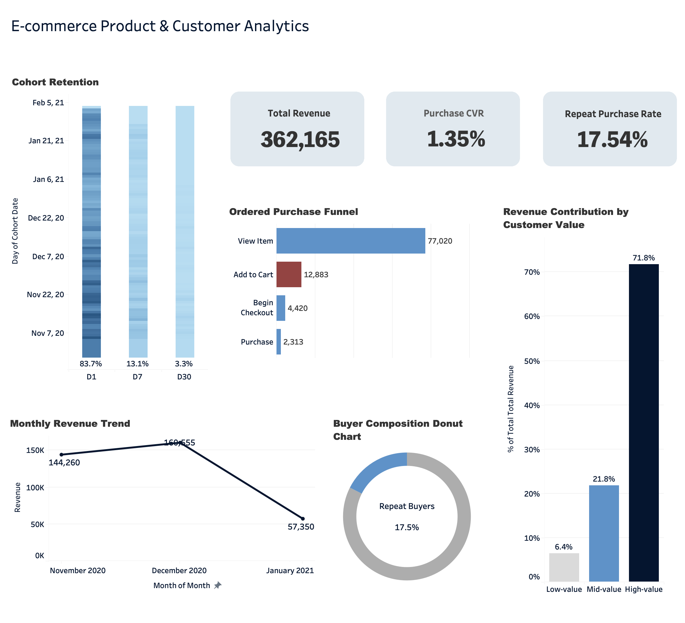

# E-commerce Product & Customer Analytics

## Introduction

I started this project to get more hands-on with business data analysis and work with the kind of user behavior data that appears in real e-commerce products.

Using the Google Analytics 4 public sample dataset, I looked at how users move through the purchase journey, where they drop off, how often they return, and how different customer groups contribute to revenue. I used SQL in BigQuery for the analysis and Tableau to present the results.

The goal was to practice turning raw event-level data into clear business insights rather than just calculating standalone metrics.

## Data Source

The project uses the Google Analytics 4 public e-commerce sample dataset in BigQuery:

`bigquery-public-data.ga4_obfuscated_sample_ecommerce.events_*`

The data covers user activity from November 2020 to January 2021.

## Analysis

### Conversion Funnel

I built an ordered funnel across:

`View Item → Add to Cart → Begin Checkout → Purchase`

The overall View-to-Purchase Conversion Rate was about **3.0%**. The largest Drop-off happened between **View Item and Add to Cart**.

### Cohort Retention

I measured whether users returned 1, 7, and 30 days after their first activity. For users who joined too late in the dataset to be observed for the full period, the unavailable Retention values were left blank instead of counted as zero.

### Customer Segmentation

Users were grouped into:

- Non-purchasers
- One-time Buyers
- Repeat Buyers

Repeat Buyers made up about **17.5% of all buyers**.

I also segmented purchasing users into Low-, Mid-, and High-value groups based on Customer Revenue.

### Revenue Trend

Revenue increased by about **11.3%** from November to December 2020, before dropping sharply in January 2021.

### Churn / Inactivity

I used 30 days of inactivity as a simple way to identify potentially churned users.

This gives a rough picture of user activity, but it should not be treated as a confirmed churn measure because users joined the dataset at different times and were not observed for the same length of time.

## Key Findings

- Session-level Purchase Conversion Rate: **1.35%**
- Ordered View-to-Purchase Conversion Rate: **3.0%**
- Largest Funnel Drop-off: **View Item → Add to Cart**
- Repeat Purchase Rate: **17.5%**
- High-value customers contributed the majority of Revenue
- Revenue grew from November to December, then declined substantially in January

## Limitations

The dataset covers a relatively short period, so some longer-term behavior cannot be observed.

The churn analysis uses a 30-day inactivity rule based on the available data, so it is only an approximation and may not reflect how churn would be defined in a real business setting.

## What I Learned

This project gave me more hands-on practice using BigQuery to work with event-level e-commerce data.

It also helped me get better at turning raw data into a clearer picture of customer behavior and business performance.
